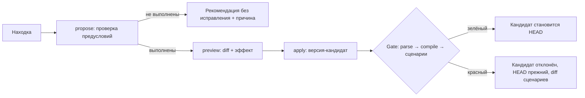
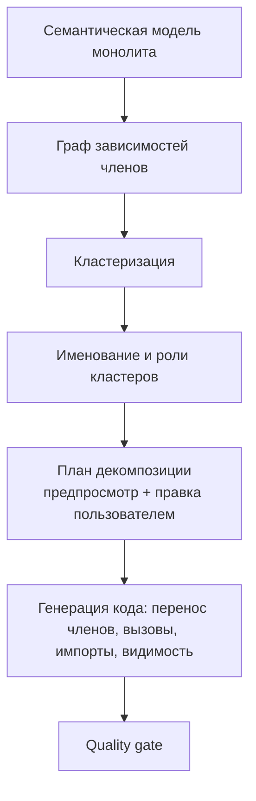

# 06. Преобразования: оптимизация, выделение метода, декомпозиция

Все автоматические преобразования детерминированы (ADR-03), оформлены единым образом и защищены **quality gate** (сборка + автоматические тесты = поведение сохранено).

## 1. Общая модель преобразования

```python
class Transform(Protocol):
    id: str                      # OPT-01, FIX-01, CLEAN-01, REF-01, REF-04
    behavior_preserving: bool    # заявляется ли сохранение поведения
    def propose(self, model, finding) -> TransformProposal | None
    def build_edits(self, proposal, model) -> list[TextEdit]

class TransformProposal(BaseModel):
    fix_id: str
    finding_id: str | None
    title: str
    summary: str                 # что изменится, одним предложением
    preconditions: list[Check]   # [{name, passed, reason}]
    effect: Effect               # {complexity_before, complexity_after, notes}
    diff: list[FileDiff]         # предпросмотр unified diff
    behavior_preserving: bool
```

Жизненный цикл: **предложение → предпросмотр → применение → quality gate → HEAD**.



## 2. Quality gate

Стадии идут по очереди; первая неуспешная останавливает проверку.

| Стадия | Проверка | Провал означает |
|---|---|---|
| `syntax` | Дерево без `ERROR`/`MISSING` | Ошибка генерации (баг преобразования) |
| `compile` | `javac` успешен | Баг преобразования (область видимости, типы, `throws`) |
| `scenarios` | Все **включённые** сценарии: нормализованный stdout/stderr, код выхода, исключение совпали с эталоном | Поведение изменилось (или сценарий нестабилен) |
| `coverage` (информативная) | Покрытие узлов затронутых методов сценариями | Предупреждение: «изменённый код не покрыт тестами», gate не проваливается, но статус «условно» |

Правила:

- Gate запускается автоматически после **каждого** автоматического преобразования и по кнопке «Проверить поведение» для ручных правок.
- Для `behavior_preserving = true` провал на стадии `scenarios` блокирует применение.
- Для `behavior_preserving = false` (FIX-*) пользователь видит, какие сценарии изменились, и сам решает (подтверждение → новый эталон для этих сценариев с записью в историю).
- Если сценариев меньше порога (по умолчанию 3) или покрытие ниже 60%, UI предупреждает: «доказательство слабое: добавьте сценарии» и предлагает «Сгенерировать» (FR-11).
- Статус версии виден всегда: «✓ поведение совпадает с эталоном (12/12)», «✗ отличается (2 сценария)», «? не проверено».

## 3. Каталог преобразований

### 3.1 Оптимизации (`OPT-*`, сохраняют поведение)

| ID | Что делает | Предусловия | Было → стало |
|---|---|---|---|
| **OPT-01** | Индексация по ключу вместо вложенного поиска пар | Внутренний цикл — поиск совпадения по ключу; тело зависит только от пары; порядок обработки не влияет на результат (или сохраняется порядком вставки через `LinkedHashMap`); нет побочных эффектов, зависящих от порядка | O(n²) → O(n) |
| **OPT-02** | `list.contains(x)` в цикле → `HashSet` | `list` не изменяется в цикле; элементы имеют корректные `equals/hashCode` (стандартные типы, `record`, String, обёртки; пользовательский класс — только при наличии обоих переопределённых методов) | O(n²) → O(n) |
| **OPT-03** | Конкатенация строк в цикле → `StringBuilder` | Переменная локальная, `String`, не используется в теле иначе, чем накопление и (после цикла) чтение | O(n²) → O(n) |
| **OPT-04** | Вынос сортировки из цикла | Сортируемая коллекция и компаратор инвариантны в цикле; результат сортировки не изменяется телом | O(n² log n) → O(n log n) |
| **OPT-05** | Вынос инварианта в переменную перед циклом | Выражение чистое и инвариантное (см. [05 § 7](05-analysis.md#7-инвариантность-и-чистота-для-безопасных-исправлений)) | снижение константы или степени |
| **OPT-06** | `LinkedList` → `ArrayList`/`ArrayDeque`; `add(0,…)` → `ArrayDeque` | Доступ по индексу в цикле; нет вызовов методов, специфичных для `LinkedList`/`Deque`, которых нет в целевом типе | O(n²) → O(n) |
| **OPT-07** | Общее подвыражение → переменная | Чистое выражение, повторяется, переменные не меняются между вхождениями | константа |
| **OPT-08** | Мемоизация чистой рекурсии | Метод чист; параметры — примитивы/обёртки/строки (ключ); тип возврата допускает кэш | O(2ⁿ) → O(n) |
| **OPT-09** | «Найти элемент по ключу или добавить» вручную → индекс `Map` (реализовано; `Map.merge` / `groupingBy` для чистых счётчиков остаются рекомендацией) | Цикл из трёх операторов: флаг, поиск с `флаг = true; break;`, `if (!флаг) накопитель.add(…)`; условие — конъюнкция равенств одних и тех же геттеров (строка, число, `enum`); тело не меняет поля ключа (транзитивно по методам проекта) | O(n²) → O(n) |
| **OPT-10** | Буферизация вывода | В цикле нет чередования вывода в stdout/stderr, чтения stdin и исключений между итерациями | константа |
| **OPT-11** | Перестановка этапов Stream (`filter` перед `sorted/map`) | Этапы без побочных эффектов | константа |
| **OPT-12** | Обёртка → примитив | Локальная переменная без `null`-использований и не передаётся как `Object`/в дженерик-коллекцию | константа |

Каждое преобразование — отдельный модуль `engine/transform/fixes/opt_NN_*.py` с тестами «до/после» (раздел 8).

### 3.2 Исправления (`FIX-*`, могут менять поведение)

`FIX-01` (`==` → `equals`), `FIX-02` (пустой `catch`), `FIX-03` (try-with-resources — сохраняет поведение, кроме `System.in`), `FIX-07` (недостижимый код), `FIX-09` (`removeIf`/итератор), `FIX-10` (`default`/`break`). Для них `behavior_preserving = false`: gate показывает расхождения, пользователь подтверждает.

### 3.3 Чистка (`CLEAN-*`)

`CLEAN-01` магические числа → константы; `CLEAN-02` удаление неиспользуемого; `CLEAN-03` переименование по соглашению. Сохраняют поведение.

### 3.4 Рефакторинги (`REF-*`)

`REF-01` выделение метода (раздел 5), `REF-02` замена клонов вызовом, `REF-03` ранние возвраты, `REF-04` декомпозиция (раздел 6).

## 4. Пакетная оптимизация («Оптимизировать» в шапке)

Кнопка в шапке запускает **план оптимизации**:

1. Берутся все исправляемые находки категорий PERF и CLEAN с `behavior_preserving = true`.
2. Преобразования упорядочиваются: сначала самые тяжёлые по сложности, затем остальные; преобразования с пересекающимися диапазонами не применяются в одном проходе.
3. Показывается диалог: список шагов с галочками, эффект и предусловия каждого, итоговая оценка «O(n²) → O(n log n)».
4. После подтверждения шаги применяются **последовательно, по одному**: каждый шаг — версия-кандидат → gate → при успехе HEAD, при провале шаг пропускается (в отчёте «пропущен: сценарий X изменился»), остальные продолжают.
5. Итог: отчёт «до/после»: сложность, LOC, число находок, время на масштабированных сценариях, статус gate.

Гарантия: на любом шаге HEAD — версия, прошедшая gate. Пользователь может откатить всю пачку одной кнопкой («вернуться к версии до оптимизации»).

## 5. Выделение метода

Цель: «Длинный метод» (MAINT-01), дублирование (MAINT-02), смешение ответственностей (MAINT-08). Это и ручная операция (выделить блоки на холсте → «Выделить в метод»), и автоматический шаг декомпозиции.

### 5.1 Алгоритм

Вход: метод `M` и непрерывная последовательность операторов `S` одного блока (уровня вложенности).

1. **Допустимость:**
   - `S` — подряд идущие операторы одного блока `{ … }`;
   - нет `break/continue`, выходящих за `S`; нет меток, пересекающих границу;
   - `return` внутри `S` допускается, если все пути в `S` заканчиваются `return`/`throw` (тогда выделяется как «хвост») либо `S` содержит единственный выход (приводится к возвращаемому значению);
   - нет `yield` вне `S`.
2. **Параметры:** переменные, **используемые** в `S` и **объявленные до** `S` → параметры (с их типами; тип-параметры метода и дженерики сохраняются).
3. **Возврат:**
   - переменные, **изменённые** в `S` и **используемые после** `S` — «выходные»;
   - 0 выходных → `void`;
   - 1 выходная → возвращаем её значение, `x = extracted(…)`;
   - ≥ 2 → вариант 1: предложить вспомогательный `record` результата; вариант 2: отказ с пояснением (в MVP — `record`, т. к. он в бонусном scope; если пользователь не принимает — отменить).
4. **Исключения:** проверяемые исключения, которые бросаются из `S` и **не** ловятся внутри `S`, становятся `throws` нового метода; `catch` вокруг вызова остаётся в вызывающем методе.
5. **Модификаторы:** `static`, если `M` статический или `S` не использует `this`; `private`.
6. **Имя:** подбор по эвристике: глагол + объект из первых выражений `S` (`validateOrders`, `printReport`, `readInput`), конфликты разрешаются суффиксом. Пользователь может переименовать до применения.
7. **Правка текста:** вставка нового метода после `M`, замена `S` вызовом (`result = name(args);`), перенос комментариев `S`.
8. **Проверка:** перепарсинг, gate.

### 5.2 Дублирование (REF-02)

Клоны: нормализованное сравнение поддеревьев (идентификаторы заменяются позиционными метками, литералы сохраняются), минимум 5 операторов. Для группы клонов:

1. Общий метод строится по первому вхождению; параметры — объединение различающихся идентификаторов и литералов (если различающихся ≤ 4).
2. Все вхождения заменяются вызовами с соответствующими аргументами.
3. Gate. Если какое-то вхождение не удаётся заменить безопасно (разные выходные переменные), оно остаётся, а в отчёт попадает пометка.

## 6. Декомпозиция монолита

Цель слайда 6: Main.java ≈1000 строк (парсинг, анализ, оптимизация, вывод) → `Parser.java`, `Analyzer.java`, `Optimizer.java`, `Main.java`. Выполняется **при необходимости** (MAINT-05 сработало или пользователь запустил вручную).

### 6.1 Этапы алгоритма



**A. Единица декомпозиции.** Члены класса: поля, методы, вложенные типы. Конструкторы и `main` обрабатываются отдельно.

**B. Граф зависимостей членов.** Вершины — члены. Рёбра с весами:

| Связь | Вес |
|---|---|
| Метод вызывает метод | 2 |
| Метод читает/пишет поле | 3 |
| Метод использует вложенный тип | 2 |
| Два метода используют общие поля (по Жаккару) | 0..3 |
| Лексическая близость имён (общий префикс: `parse*`, `print*`) | 1 |

Метод ввода-вывода (читает stdin/пишет stdout) получает метку «I/O», методы без доступа к полям — метку «чистый».

**C. Кластеризация.** Louvain (networkx) с фиксированным `seed`, затем:
- слияние слишком малых кластеров (< 2 методов) с самым связанным;
- разделение кластера, объединяющего I/O и вычисления, если связь слабая;
- результат: от 2 до ~7 кластеров.

**D. Имя и роль кластера.** Лексикон ролей по глаголам в именах методов:

| Роль | Ключевые слова | Класс по умолчанию |
|---|---|---|
| Parser | `parse`, `read`, `tokenize`, `load`, `scan`, `input` | `Parser` |
| Analyzer | `analyze`, `calc`, `count`, `check`, `validate`, `find`, `detect`, `compute` | `Analyzer` |
| Optimizer | `optimize`, `transform`, `rewrite`, `simplify`, `fold`, `reduce` | `Optimizer` |
| Printer | `print`, `format`, `render`, `write`, `report`, `show`, `output` | `Printer` / `Reporter` |
| Model | кластеры, в основном из полей и геттеров | существующий тип или `<Имя>Data` |
| Util | прочее | `<Имя>Utils` |

Если ни одно слово не подошло, класс называется `<Основное существительное>Service`. Пользователь может поменять имя в плане.

**E. План декомпозиции.** UI показывает:
- «До» — монолит с метриками;
- «После» — карточки классов: имя, члены, строки, связи между классами;
- перенос методов между карточками (drag-and-drop) → пересчёт связей и предупреждения («метод использует 5 полей из другого класса»): после каждой правки UI вызывает `POST /decompose/rescore`, который пересчитывает строки классов, связи, предупреждения и метрики «после», не генерируя код; закреплённые члены (`pinned` в плане) перенести нельзя;
- кнопку «Применить».

**F. Генерация.** Для каждого кластера:

1. Создаётся новый файл `<Имя>.java` в том же пакете.
2. Члены переносятся **как текст** (вместе с комментариями и аннотациями).
3. **Поля, общие между кластерами:**
   - константы (`static final`) — переносятся в класс-владелец и доступны как `Owner.CONST`;
   - изменяемое состояние, используемое одним кластером, — переезжает в него;
   - изменяемое состояние, используемое несколькими, — остаётся в «ядре» (Main или новый `<Имя>State`); кластерам передаётся через конструктор.
4. **Статические методы** — остаются статическими (`Parser.parse(...)`); вызовы в оставшихся местах переписываются на `Класс.метод`.
5. **Экземплярные методы** — класс получает конструктор с зависимостями (`private final Parser parser;`); вызовы переписываются на `parser.parse(...)`.
6. **Видимость:** `private` у переносимых методов, вызываемых из других классов, повышается до package-private.
7. **Импорты** — собираются по использованным типам.
8. **Nested-типы** — переносятся с зависимыми методами или выносятся в отдельные файлы (по числу использований).
9. `Main` остаётся с `main`, конструированием зависимостей и оркестрацией.

Реализация: пакет `engine/transform/decompose/` оперирует `ProjectEdit` — набором операций (`create_file`, `move_member`, `rewrite_call`, `add_import`, `change_visibility`) поверх текстовых правок; в `Version.meta` записывается `symbol_moves`.

### 6.2 Ограничения MVP и обработка отказов

| Ситуация | Поведение |
|---|---|
| Нестатические внутренние классы, зависящие от `this` | Остаются в классе-владельце (кластер «ядро») |
| Анонимные классы и лямбды, захватывающие `this` | Перенос вместе с методом; если захватывают поле из другого кластера — предупреждение |
| Циклическая зависимость между кластерами | Предупреждение и рекомендация объединить; пользователь может применить как есть (допустимо для Java) |
| Наследование монолита | Классы с `extends` пользователя не декомпозируются автоматически (только предложение) |
| `static`-инициализация, зависящая от порядка | Блоки инициализации не двигаем, остаются в ядре |
| Gate красный | Откат; пользователю показывается причина (ошибка компиляции с файлом и строкой либо diff сценария) |

### 6.3 Критерии приёмки декомпозиции

- Демо-монолит (≈1000 строк) разбивается на ≥ 3 класса, `javac` проходит, все сценарии зелёные.
- Размер `Main.java` уменьшается не менее чем вдвое.
- Метрика LCOM4 по новым классам не хуже, чем у исходного (в среднем).
- Повторный запуск с теми же настройками даёт идентичный результат (детерминизм).

## 7. Предпросмотр и отмена

- Для любого преобразования доступен предпросмотр: diff в Monaco + список файлов + эффект.
- Применение создаёт одну версию с `origin`: `autofix` / `optimize` / `extract_method` / `decompose`.
- Отмена — undo (возврат HEAD). Кандидаты, отклонённые gate, остаются в истории со статусом `rejected` для разбора.

## 8. Тестирование преобразований

| Тест | Что проверяет |
|---|---|
| Пара «до/после» на каждый `OPT-*` | Текст после преобразования совпадает с эталонным (golden-файл) |
| Gate-тест на каждый `OPT-*` | Компиляция + сценарии: вывод до и после идентичен |
| Тест предусловий | Отрицательные примеры: преобразование не применяется (например, `merge` зависит от порядка) |
| Идемпотентность | Повторное применение к результату ничего не меняет |
| Property-тест выделения метода | На корпусе: для любого допустимого фрагмента результат компилируется |
| Декомпозиция на корпусе | `javac` + сценарии + детерминизм |
| Размер эффекта | Сложность до/после совпадает с заявленной (проверка оценщиком Big O) |

## 9. Расширяемость

Новое правило или преобразование = один модуль + регистрация в `rules/__init__.py` / `fixes/__init__.py` + тесты «до/после». Контракт `Transform` и общий gate не меняются.
