# План разработки MVP

План рассчитан на **48-часовой хакатон**. Он покрывает **100% базового функционала** (FR-01…FR-21, обязательный Java scope, разделы 1–4) и **все бонусные возможности** (record, enum, дженерики, лямбды, Stream API). Всё, что вне рамок кейса, в план не входит: многопоточность, рефлексия, файловые операции, сеть, `java.time`.

Часы считаются от старта хакатона (**H0**). Время старта в ТЗ не указано, поэтому привязку к календарю нужно сделать при старте (см. [«Привязка к календарю»](#привязка-к-календарю)).

## Этапы

| Этап | Название | Часы | Трек | Результат этапа |
|---|---|---|---|---|
| [S0](s0-scaffold.md) | Каркас и окружение | H0–3 | все | Репозиторий, backend/frontend-скелеты, Docker, CI, спайк tree-sitter |
| [S1](s1-contract-corpus.md) | Контракт API и корпус примеров | H2–6 | A, B, C | Pydantic-схемы → OpenAPI → TS-типы, моки, демо-монолит и фикстуры scope |
| [S2](s2-parse-graph.md) | Разбор Java и построение графа | H3–14 | A | Семантическая модель, граф структуры и блок-схемы, стабильные ID |
| [S3](s3-backend-core.md) | Backend: проекты, версии, сборка, запуск | H6–16 | B | Импорт, версии, `javac`/`java`, SSE, эндпоинты графа |
| [S4](s4-frontend-workspace.md) | Frontend: рабочая область и граф | H10–24 | C | Раскладка по макету, дерево, Monaco, холст графа, консоль |
| [S5](s5-editing.md) | Двусторонняя правка: граф ↔ код | H16–28 | A, C | Операции над графом, палитра, инспектор, undo/redo |
| [S6](s6-verification.md) | Проверка поведения и сценарии | H14–32 | B, C | Эталон, сравнение, gate, трассировка, генератор сценариев, бенчмарк |
| [S7](s7-analysis.md) | Диагностика, Big O и метрики | H22–34 | A, C | Оценка сложности, каталог правил, панель «Анализ» |
| [S8](s8-optimization.md) | Оптимизация | H30–40 | A, B, C | Автоисправления, пакетная оптимизация, измеренное ускорение |
| [S9](s9-extract-decompose.md) | Выделение метода и декомпозиция | H34–44 | A, C | Extract method, клоны, декомпозиция монолита |
| [S10](s10-polish-submission.md) | Полировка, демо и сдача | H40–48 | все | Приёмка A1–A9, документация, демо, комплект сдачи |

Этапы перекрываются по времени: ниже диаграмма и критический путь.

## Ход выполнения

Сводка обновляется после каждого этапа; детали по задачам, отклонения и ограничения — в таблицах «Статус выполнения» файлов этапов. Состояние: ✅ сделано, ⚠️ сделано частично, 🔧 в работе, ⏳ не начато.

| Этап | Состояние | Что осталось или не проверено |
|---|---|---|
| [S0](s0-scaffold.md) | ✅ | Docker-образы собираются и запускаются; CI на GitHub не запускался |
| [S1](s1-contract-corpus.md) | ✅ | корпус проверен на JDK 17; JDK 21 проверит CI; до 6 монолитов к H24 сделано 4 |
| [S2](s2-parse-graph.md) | ⚠️ | каталог типов JDK, эффекты и чистота методов (S2.3/S2.4), типы этапов Stream |
| [S3](s3-backend-core.md) | ✅ | проверено на Windows с JDK 17 и в Docker (Linux, JDK 21: весь pytest, лимиты `setrlimit`/`killpg`); живой вывод программы приходит в SSE после завершения запуска |
| [S4](s4-frontend-workspace.md) | ✅ | E2E-сценарии, нагрузка холста (166 блоков, INP 24–40 мс) и аудит доступности WCAG 2.1 A/AA (6 экранов × 2 темы) готовы; образ frontend собирается |
| [S5](s5-editing.md) | ✅ | правка кода и графа, палитра, инспектор, жесты, undo/redo, история, вставка в `case`-группы, константы enum, компоненты record, I6, выбор нескольких блоков (Shift/Ctrl+клик и рамкой), блоки из палитры попадают в ветки `switch` (классические и со стрелкой), E2E `undo_redo`, `code_to_graph`, `switch_insert` и `rubber_band` готовы; блок «Код» правится в многострочном поле, а не в Monaco-мини |
| [S6](s6-verification.md) | ✅ | эталон, test, gate (синтаксис, компиляция, сценарии, покрытие), трассировка, схема ввода и генератор сценариев, бенчмарк с показателем роста, `scripts/verify_samples.py`, I5 и нагрузка на 15 сценариях; UI: панель «Результат тестов», диалог генерации, график роста, «Проверить» в карточках находок; E2E `negative_control` проходит |
| [S7](s7-analysis.md) | ✅ | модель Big O, метрики, каталог правил целиком (PERF-01…12, BUG-01…11, MAINT-01…10), API и динамическая проверка находок готовы; панель «Анализ»: проблемы с фильтрами, «Проверить», рекомендации, метрики «Оригинал → Текущая», маркеры в редакторе; E2E `diagnostics` проходит, нет вкладки «Анализ узла» для произвольного фрагмента; в таблице Big O 42 случая вместо 60, нет сводного «здоровья» |
| [S8](s8-optimization.md) | ⚠️ | автоисправления OPT-01…09, 11, 12, 13, FIX-01/02/03/07/09/10, CLEAN-01/02/03 и REF-02, кандидаты, пакетная оптимизация, gate и измеренное ускорение готовы; UI: предпросмотр и применение исправления со стадиями gate, «принять/отклонить» для кандидатов, диалог «Оптимизировать» с отчётом и откатом; нет OPT-10 (меняет вывод); E2E `optimize_all` проходит |
| [S9](s9-extract-decompose.md) | ✅ | выделение метода (REF-01), замена клонов (REF-02), декомпозиция монолита (REF-04) с отказами; UI: диалог «Выделить в метод» (холст, меню, Monaco, карточки находок), вкладка «Декомпозиция» с переносом методов между карточками, пересчётом связей и применением со стадиями gate; E2E `decompose` проходит |
| [S10](s10-polish-submission.md) | ⚠️ | сделаны: отчёт приёмки ([13](../13-acceptance.md)), баг-баш корпуса, бюджеты производительности, `SOLUTION.md`, README, `make submit`, «готовый» демо-проект; не сделаны: запуск E2E в CI, видео-запись демо, тег `v1.0-demo`, отправка ссылки; `docker compose` и JDK 21 проверены в Docker (рабочая копия, не свежий клон) |

### Где остановились и что дальше

**Остановились на:** **S9 (UI) закончен, весь функционал M5 реализован.** Выбор нескольких блоков на холсте (Shift+клик — подряд идущие блоки слота, Ctrl+клик) с панелью действий; диалог «Выделить в метод» (имя с живым предпросмотром, сигнатура, предусловия, diff, стадии gate) открывается из панели, контекстного меню блока, меню Monaco и карточек находок MAINT-01/08; вкладка «Декомпозиция»: «До» с метриками монолита, «После» с карточками классов, перенос методов перетаскиванием или меню, новый класс, переименование, предупреждения и связи, «Применить…» с предпросмотром файлов. Backend получил `POST /decompose/rescore` (пересчёт строк, связей, предупреждений и метрик правленного плана, отказ с причиной) и поле `pinned` в плане (закреплённые в ядре члены). Применение кандидата (стадии gate, «принять»/«отклонить», новый эталон) вынесено в общий `candidate-run.tsx`. Через браузер на живом backend: отредактированный план `demo-orders` (перенос метода + переименование) применился — 4 стадии и 11 из 11 сценариев зелёные; выделение двух блоков цикла `run` с новым именем — тоже зелёное; фрагмент с `continue` отклонён с причиной. Frontend: 269 тестов Vitest, `tsc` и ESLint чистые. Известные ограничения: рамкой блоки не выбираются; после применения декомпозиции вкладка сразу строит план для уже уменьшенного `Main` (с предупреждениями о циклах и общих полях).

**Дальше:** (1) S10 (остаток): запуск CI на GitHub (в том числе `pnpm e2e`) и проверка со свежего клона, видео демо, тег `v1.0-demo`, отправка ссылки; (3) долги: каталог типов JDK, эффекты и чистота методов (S2.3/S2.4), монолиты 5–6 (S1.7), OPT-10, JDK 21/Docker/CI.

Выполнено:

- [x] **S0** каркас: backend, frontend, БД, CI, Docker (сборка Docker и CI на GitHub не запускались)
- [x] **S1** контракт API, моки frontend, корпус `samples/`, `verify_corpus.py`
- [x] **S2** разбор и граф: символы, блок-схемы, структура, ID, `locate`, инварианты I1 и I3
- [x] **S3** backend-ядро: импорт, версии и файлы, сборка, запуск, SSE, граф, экспорт исходников, сидирование
- [x] **S4** frontend-рабочая область (чтение): проекты и импорт, дерево, вкладки методов, холст блок-схемы (React Flow + ELK в Worker, контейнеры, внешние вызовы), граф структуры, Monaco, синхронизация код ↔ граф, запуск и консоль, панели «Результат тестов» и «Анализ» (E2E и Docker-образ не проверялись)
- [x] **S5 (backend)** операции над графом: вставка, правка, удаление, оборачивание, ветки, перемещение, члены, переименование; `POST /ops`, `/ops/validate`, `/palette`, `/validate/expression`
- [x] **S5 (UI)** правка кода в Monaco (`/parse`, автосохранение, `409`), палитра из `GET /palette`, инспектор (react-hook-form + zod, `/validate/expression`, предпросмотр по `/ops/validate`), жесты холста и контекстное меню, перемещение блоков, undo/redo, «История версий» с DiffEditor
- [x] **S6 (часть A)** сценарии (CRUD, импорт, экспорт), нормализация, эталон с двойным прогоном и масками, сравнение, запуски `baseline`/`test`/`gate`, отчёты JSON/Markdown/JUnit, сводный отчёт и комплект сдачи
- [x] **S8 (ядро)** автоисправления OPT-02/03/06 и FIX-01/02 с предусловиями и предпросмотром; кандидаты (`apply`, `accept`, `reject`), gate продвигает кандидата в HEAD; `optimize/plan` и `optimize/apply` со `step`-событиями; I8 на `demo-orders`
- [x] **S7 (ядро)** модель стоимости Big O, метрики и клоны, правила PERF-01/02/03/04/06/08, BUG-01/02/07/09/10, MAINT-01…07, 09, 10; `GET /analysis`, `/findings`, `/complexity`, `/metrics`; сложность и бейджи находок в графах

Не выполнено, в порядке работы:

- [x] **S6 (UI)**, **S7 (UI)**, **S8 (UI)**: «Дебаг», тесты и gate, генератор, «Проверить», панель «Анализ», предпросмотр и применение исправлений, диалог «Оптимизировать»
- [x] Playwright E2E `demo_full_path`, `code_to_graph`, `undo_redo`, `negative_control`, `diagnostics`, `optimize_all`, `decompose`, `export` (`frontend/e2e`, проходят локально в Edge; job `e2e` в CI не запускался)
- [x] **S5 (backend, остаток)** вставка в `case`-группы `switch`, константы `enum`, компоненты `record`, инвариант I6
- [x] **S5 (UI, остаток)** вставка в ветки `switch` и выбор блоков рамкой (Shift+перетаскивание по полю); блок «Код» правится многострочным полем с `replace_code` — Monaco-мини не делался сознательно
- [x] **S9 (UI)** выделение метода (S9.4) и вкладка «Декомпозиция» (S9.9): выбор блоков, диалог выделения, перенос методов между карточками, `decompose/rescore`, применение со стадиями gate
- [x] **S6.6–S6.7** инструментирование (`JbTrace`), запуск `trace`, покрытие блоков, «Дебаг» на схемах (счётчики, серые невыполненные блоки, сводка покрытия)
- [x] **S6 (часть B)** стадия `coverage` у gate, схема ввода и генератор сценариев (`POST /scenarios/generate`, автоэталон), бенчмарк (показатель роста `k`), `scripts/verify_samples.py`
- [x] **S7.7** динамическая проверка находок: `POST /findings/{id}/verify` (бенчмарк, `evidence.dynamic`)
- [x] **S7.6** остальные правила каталога: PERF-05/07/09–12, BUG-03…06/08/11, MAINT-08 (`rules_more.py`)
- [x] **S8.7** измеренное ускорение и показатель роста до/после (`summary.data.measured`)
- [x] **S9.1–S9.2, S9.5–S9.10** выделение метода и декомпозиция монолита (backend): `extract-method/preview|apply`, `decompose/plan|rescore|preview|apply`
- [x] **S8.2–S8.5, S9.3, S9.8** OPT-01/04/05/07/08/11/12, FIX-03/07/09/10, CLEAN-01/02/03, REF-02 (клоны), отказы декомпозиции
- [ ] **S8 (остаток)** OPT-10 (буферизация вывода) — меняет поток вывода
- [x] **S10 (документы и проверки)** приёмка A1–A9 ([13-acceptance.md](../13-acceptance.md)), баг-баш, бюджеты и прочность на исходниках JDK (`scripts/bug_bash.py`, `perf_budget.py`, `jdk_sweep.py`), `SOLUTION.md`, `make submit`
- [x] **S10.7** `docker compose up` и JDK 21 проверены в Docker (сборка, запуск, весь pytest в Linux-контейнере, E2E против compose; найдено и исправлено три дефекта)
- [ ] **S10 (остаток)** запуск GitHub Actions и проверка со свежего клона, видео демо, тег `v1.0-demo`, отправка ссылки HR
- [ ] долги: каталог типов JDK, эффекты и чистота методов (S2.3/S2.4), монолиты 5–6 (S1.7), запуск CI на GitHub

Журнал (новые записи сверху):

| Дата | Что сделано | Коммит |
|---|---|---|
| 2026-10-25 | S5 (остаток): вставка блоков в ветки `switch` — `slots.ts` (`case[n]` как слот `body`, бросок и клик на ветку кладут блок перед `break`), backend: вставка в ветку с блоком `case 1: { … }` по индексам графа, в стрелочное правило (одиночный оператор превращается в блок), удаление, копирование и перемещение операторов ветки; выбор рамкой (`rubberBandSelection`: отрезок одного слота от первого оператора до последнего, рамка накрывает блок целиком); E2E `switch_insert` и `rubber_band` | см. `git log` |
| 2026-10-25 | S10.3: `e2e/accessibility.spec.ts` (axe-core, WCAG 2.1 A/AA, 6 экранов в светлой и тёмной теме) нашёл и закрыл нарушения: контраст `--primary` и `--primary-foreground` тёмной темы, имена кнопок дерева, структура `tablist`/`tab`, подписи ссылки и кнопки масштаба; `e2e/canvas-perf.spec.ts` — схема из 166 блоков, INP 24–40 мс | см. `git log` |
| 2026-10-25 | S10.7: проверка в Docker. `docker compose build/up` с нуля, backend на JDK 21.0.12, демо-проект с зелёным gate, E2E 8/8 против контейнеров, весь pytest в Linux-контейнере — 1399/1399. Найдены и исправлены: путь к `samples` в контейнере (`JB_SAMPLES_DIR`), гонка в SSE (`finished` после `done`), `/bin/sleep` в тесте дерева процессов | см. `git log` |
| 2026-10-24 | S8.4: `PERF-13` + `OPT-13` (метод-поиск по ключу в поле-коллекции → индекс `Map`, который ведётся вместе со списком: `engine/analysis/lookup.py`, `engine/transform/fixes_index.py`); на `demo-orders` исправляет `findOrderById` (k 1,80 → 1,00, блоков в 9,2× меньше, «Проверить» подтверждает k ≈ 2,00 до правки); отчёт оптимизации показывает и число блоков, и время (`work_speedup`, `time_speedup`): время `demo-orders` не меняется (≈ 1,0×), в приёмке описано честно | см. `git log` |
| 2026-10-24 | S8.4, S10.2: `OPT-09` («найти по ключу или добавить» → индекс `Map`; `PERF-09` срабатывает и при обновлении найденного элемента вызовом метода; на счётчике повторов ускорение ×5,65, на `demo-orders` ≈ 1,1×: узкое место — `findOrderById` в цикле ввода, в приёмке исправлено); `scripts/jdk_sweep.py` (120 крупнейших файлов JDK: блок-схемы, анализ, все предпросмотры, I2) нашёл и закрыл три дефекта: `FIX-02` в `catch { /* … */ }` на одной строке, потеря типа varargs-параметра в `dataflow`, квадратичный обход в `CLEAN-01`; отчёт `reports/jdk_sweep.md` | см. `git log` |
| 2026-10-24 | S9.4, S9.9 (UI): выбор нескольких блоков (`selectedIds`, `siblingRange`, `SelectionBar`), диалог «Выделить в метод» (`ExtractDialog`; запуск из панели, меню блока, меню Monaco с `Ctrl+Alt+M` и карточек MAINT-01/08), вкладка «Декомпозиция» (`components/decompose/*`, `lib/decompose/*`): «До/После», карточки классов с переносом методов (drag-and-drop и меню), новый класс, переименование, связи, предупреждения, предпросмотр файлов и применение. Общий поток кандидата `candidate-run.tsx` (`useCandidateRun`, `CandidateOutcome`, `CandidateDecision`) заменил копию в `FixDialog`. Backend: `rescore` (строки классов, связи, предупреждения, метрики «после» по правленному плану; план проверяется как при предпросмотре), `POST /decompose/rescore`, поле `pinned` в плане; `preview` возвращает пересчитанный план. Моки: фикстуры `decompose-plan`, `extract-preview` из настоящего движка, `mock-fetch` читает тело запроса. Найдено и исправлено: причина предусловия, совпадающая с названием, печаталась дважды; панель выбора блоков перекрывала переключатели оверлеев. Тесты: 6 модульных и 1 интеграционный backend, в frontend 45 новых (всего 269), `tsc`, ESLint и ruff чистые; через браузер на живом backend проверены перенос метода, переименование, применение плана `demo-orders` (11 из 11), выделение метода с gate и отказ для фрагмента с `continue`. Полный прогон backend: 1349 тестов зелёные, кроме `test_benchmark_api.py`: проверки показателя роста по времени нестабильны на этой машине (по `time_ms` k выходит 2,5–3,1 при допуске 2,3, проваливается то квадратичный, то линейный случай), код бенчмарка не менялся; счётчик `growth_hits_k` стабилен (2,0) | `git log`: «S9.4, S9.9…» |
| 2026-10-24 | S7.8, S8.8 (UI): панель «Анализ» (`components/analysis/*`, `lib/analysis/*`): фильтры по важности, категории и файлу; «Проверить» по SSE с графиком роста; вкладка «Метрики» «Оригинал → Текущая»; блок «Оценка производительности»; маркеры находок в Monaco. Диалог исправления (предпросмотр: сложность, предусловия, diff со свёрнутыми неизменными областями; «Применить» со стадиями gate; «принять»/«отклонить» кандидата и перезапись эталона) и диалог «Оптимизировать» (шаги с галочками, статусы шагов, отчёт с измеренным ускорением и графиком, «Откатить всё»); редактор только для чтения, пока сервер меняет HEAD (`useEditLock`); стадии gate вынесены в общий `gate-stages.tsx`. Найдено и исправлено: `DiffEditor` бросал «TextModel got disposed before DiffEditorWidget model got reset» при закрытии диалога (модель отцепляется до удаления); запуск не считался идущим до первого события SSE (`isInProgress`). Тесты: 37 модульных и 22 компонентных новых (всего 224 в frontend), `tsc` и ESLint чистые; через браузер на живом backend проверены «Проверить», применение OPT-02, FIX-01 с красным gate, оптимизация `demo-orders` с откатом | `git log`: «S7.8, S8.8…» |
| 2026-10-24 | S9.1–S9.10 (backend), S6.3–S6.4, S6.8–S6.10, S7.7, S8.7: выделение метода (`dataflow.py`, `extract_method.py`, `extract-method/preview|apply`) и декомпозиция монолита (граф зависимостей, Louvain с фиксированным seed, роли и имена, генерация «ядро хранит состояние» с `core.`-обращениями, `decompose/plan|preview|apply` с кандидатом и gate, `symbol_moves`); генератор сценариев и бенчмарк подключены к API; gate получил стадию `coverage`; `verify_samples.py` прогоняет корпус через API. Проверено: пять монолитов раскладываются на ≥ 3 класса, компилируются, 9–11 сценариев зелёные, `Main.java` уменьшен вдвое (у `demo-orders` 995 → 387 строк); повторная генерация даёт те же файлы. Тесты: 1250 в backend (JDK 17), включая 14 модульных на план и генерацию и 12 интеграционных на декомпозицию. Отложено: клоны REF-02, отказы для вложенных нестатических классов и наследования монолита, UI | `git log` («S9.5-S9.10…») |
| 2026-10-24 | S6.6–S6.7: `engine/runtime/instrument.py` + `java/JbTrace.java` (пакет `jbtrace`): вставки `hit`/`cond` по блокам графа, номера строк копии не меняются; циклы считают итерации и входы, условия `if` — исходы, лямбды-выражения и стрелки `switch`-выражения оборачиваются в блоки; запасные уровни (без `cond`, без лямбд) при ошибке компиляции копии. `kind=trace` (свой ввод, сценарии или все), `items[].hits`, `summary.coverage/data` (покрытие, невыполненные, неинструментированные с причиной, исходы условий). UI «Дебаг»: диалог, `debug-store`, чипы `×N` и серые невыполненные блоки, сводка покрытия в панели оверлеев. Проверено: вывод и код выхода инструментированной копии совпадают с оригиналом на всех сценариях корпуса (монолиты, `scope`); 11 сценариев `demo-orders` покрывают 90% блоков; в браузере на живом backend счётчики и покрытие 90% видны на схеме `run(Scanner)`. Тесты: 20 модульных + 6 интеграционных backend, 7 frontend. **Прототип S6.8–S6.9** (не подключён к API): вывод схемы ввода (`input_schema.py`: токены, циклы по счётчику и до EOF, цикл команд с метками, словарь констант), seed-набор, мутации и поиск с обратной связью по покрытию (`inputs.py`, `search.py`); без существующих сценариев `demo-orders` покрывается на 89% за 400 запусков и 30 с (monoliths: text-analyzer 91%, graph-paths 73%, expression-calculator 70%, inventory 50%); 7 модульных тестов без JDK. Отложено: `gate` без стадии `coverage`; на JDK 26 не проверялись Docker и Linux | см. `git log` («S6.6–S6.7…») |
| 2026-10-24 | S5 (UI): правка на холсте и в коде. Слой правок (`lib/edit/*`: очередь запросов проекта, слоты вставки по структурным id, минимальная правка текста для Monaco), хранилище `editor-store`, палитра из API, инспектор, контекстное меню, перетаскивание, undo/redo и история с DiffEditor; 58 новых тестов frontend (всего 151), `testTimeout` 20 с (первый тест файла не укладывался в 5 с). Найдено и исправлено в backend: единица отступа определялась по строкам ` * …` javadoc, поэтому `wrap_node` сдвигал тело на 1 пробел | `git log`: «S5 (UI): правка кода и графа…» |
| 2026-10-24 | S4: рабочая область `/projects/[id]`, экран проектов с импортом, холст (React Flow + ELK Worker), граф структуры, Monaco из `public/monaco`, синхронизация код ↔ граф, запуск и консоль; 66 новых тестов (всего 93). Исправлено в backend: относительный `JB_DATA_DIR` ломал `javac @sources.txt` и `-cp` при запуске не из `backend/`; сбой окружения без привязки к файлу залипал в кеше сборки | `git log`: «S4: frontend workspace…» |
| 2026-10-24 | S8: исправления OPT-02/03/06, FIX-01/02, кандидаты и gate, пакетная оптимизация; на `demo-orders` 4 шага, 11 сценариев зелёные | `3462a90` |
| 2026-10-24 | S5 (backend), S6 часть A, S7 ядро: операции над графом, эталон/test/gate, отчёты, модель Big O, метрики и 12 правил; 274 новых теста (всего 1127) (JDK-набор: gate, ops) | `3462a90` |
| 2026-10-24 | S3.1–S3.3, S3.6–S3.9: импорт, версии и файлы, граф, `POST /build`, запуски `run` и SSE, экспорт исходников, сидирование; 93 теста API (16 с JDK); `OpenAPI`/`schema.d.ts` перегенерированы; найден и исправлен `\r\n` в выводе JVM на Windows | ветка `feat/s1-contract-corpus`, `3462a90` |
| 2026-10-24 | S3.4–S3.5: рабочее пространство, `javac` с диагностиками и кешем, запуск `java` с лимитами и убийством дерева процессов; 19 тестов, 10 из них с JDK | `git log`: «S3.4-S3.5: build and run runtime…» |
| 2026-10-24 | S2: символы, блок-схемы всех операторов, структура, ID, `locate`, инварианты I1/I3 на корпусе; моки frontend строятся движком | `78a4aef` |
| 2026-10-23 | S1: контракт API (65 эндпоинтов-заглушек), моки frontend и экран `/preview`, корпус `samples/` (демо-монолит, 38 фикстур scope, 4 монолита, `broken`, `out-of-scope`), `verify_corpus.py` | `4cacdfa` |
| 2026-10-23 | Исправлен CI-тест `/api/health`, зависевший от версии JDK на машине | `8c7e5b2` |

## Диаграмма

```mermaid
gantt
    title План MVP (часы от старта)
    dateFormat  X
    axisFormat  H%s
    section Основа
    S0 Каркас               :s0, 0, 3
    S1 Контракт и корпус    :s1, 2, 4
    section Engine (A)
    S2 Разбор и граф        :s2, 3, 11
    S5 Правка (engine)      :s5a, 16, 12
    S7 Анализ               :s7, 22, 12
    S8 Оптимизация          :s8, 30, 10
    S9 Extract и декомпозиция :s9, 34, 10
    section Backend/Runtime (B)
    S3 Backend core         :s3, 6, 10
    S6 Проверка поведения   :s6, 14, 18
    section Frontend (C)
    S4 Рабочая область      :s4, 10, 14
    S5 Правка (UI)          :s5b, 20, 8
    S10 Полировка и сдача   :s10, 40, 8
```

**Критический путь:** S0 → S2 (разбор и граф) → S3 (API графа) → S4 (холст) → S5 (операции) → S6 (gate) → S8 (оптимизация) → S9 (декомпозиция) → S10. Задержка S2 или S6 сдвигает всё; им отдаются лучшие ресурсы.

## Вехи

| Веха | Час | Что должно работать | Проверка |
|---|---|---|---|
| **M0** Каркас | H6 | `docker compose up` показывает пустое приложение, CI зелёный, контракт API и TS-типы есть, `demo-orders` в корпусе, tree-sitter работает на Windows и в Docker | Ручная проверка, CI |
| **M1** Вертикальный срез | H24 | Загрузка `.java` → дерево проекта → блок-схема метода → клик по блоку подсвечивает код → правка кода обновляет граф → «Запуск» со stdin → ручные сценарии, эталон и gate «сборка + сценарии» | E2E `demo_full_path` (без правки графа) |
| **M2** Правка и проверка | H32 | Все операции над графом, undo/redo, палитра и инспектор; генератор сценариев, трассировка, покрытие, бенчмарк (FR-05…FR-12, FR-20 частично) | E2E `code_to_graph`, `undo_redo`, `negative_control` |
| **M3** Диагностика | H34 | Big O, ядро каталога правил, панель «Анализ», проверка находок (FR-13…FR-15, FR-21) | E2E `diagnostics`, таблица Big O |
| **M4** Оптимизация | H40 | Ядро оптимизаций и пакетная кнопка «Оптимизировать», измеренное ускорение (FR-16) | E2E `optimize_all`, I8 |
| **M5** Заморозка | H42 | Выделение метода и декомпозиция (FR-17, FR-18). Новые возможности больше не добавляются | E2E `decompose`, I9 |
| **M6** Сдача | H48 | Демо репетировано, комплект сдачи собран, чистый клон поднимается | Чек-лист [12 § 3](../12-demo-and-submission.md#3-чек-лист-сдачи) |

### Привязка к календарю

Промежуточная проверка: к **08:00 25.10** нужно отправить HR (@ekaterina_axenix) ссылку на репозиторий; работа после этого продолжается. При старте хакатона:

1. Записать фактическое время H0 и пересчитать вехи в календарные часы.
2. Убедиться, что к промежуточному сроку готов минимум M1 (вертикальный срез); если срок наступает раньше H24, ускорить S4 за счёт моков и приоритета минимального графа (без контейнеров и оверлеев).
3. Если срок наступает позже, к нему должны быть готовы M2–M3; в README показать раздел «Статус».

## Треки и распределение

План написан под **трёх исполнителей**. Если людей меньше, треки сливаются в порядке критического пути.

| Трек | Зона | Основные этапы |
|---|---|---|
| **A. Engine** | `backend/engine/{java,graph,edit,analysis,transform}` | S2 → S5 (engine) → S7 → S8 (engine) → S9 |
| **B. Backend/Runtime** | `backend/app`, `engine/runtime`, `engine/verify` | S3 → S6 → S8 (gate, бенчмарк) |
| **C. Frontend** | `frontend/` | S4 → S5 (UI) → S6 (UI) → S7 (UI) → S8 (UI) → S9 (UI) → S10 |

Правила работы:

1. **Contract-first.** Frontend начинает на моках из S1 и переходит на реальный API по мере готовности эндпоинтов S3.
2. **Один владелец модуля.** Конфликты правок в одном файле минимизируются границами модулей.
3. **Trunk-based:** короткие ветки `feat/sN-…`, PR в `main`, CI зелёный перед merge, ревью на лету.
4. **Каждая задача завершается тестом** (модульный, инвариантный или E2E) — иначе она не закрыта.
5. **Ежедневные синхронизации** (каждые 4–6 часов, 10 минут): статус вех, блокеры, изменения контракта.

## Приоритеты внутри этапов: «ядро» и «расширение»

Задачи с каталогом правил и оптимизаций разбиты на **ядро** и **расширение**. Это порядок работы, а не отказ от объёма: в MVP входит всё, но если график трещит, ядро гарантирует, что демо и ключевые критерии оценки закрыты.

| Область | Ядро (до M3/M4) | Расширение (до M5) |
|---|---|---|
| Правила анализа | PERF-01, 02, 03, 06; BUG-01, 02; MAINT-01, 02, 03, 05 | остальные PERF/BUG/MAINT из [05 § 5](../05-analysis.md#5-каталог-правил) |
| Оптимизации | OPT-01, 02, 03; FIX-01, 02 | OPT-04…12; FIX-03, 07, 09, 10; CLEAN-01…03; REF-03 |
| Операции над графом | Все операции из [04 § 5.2](../04-code-graph-model.md#52-граф--код-операции) | — (обязательны) |
| Scope-фикстуры | Разделы 1–4 | Бонус (record/enum/дженерики/лямбды/Stream) идёт параллельно, но блокирует M5, если не зелёный |

Бонусный scope **не откладывается на конец**: фикстуры и разбор `record`/`enum`/дженериков/лямбд/Stream делаются в S2 вместе с основным.

## Матрица покрытия ТЗ

### Функциональные требования

| FR | Название | Этапы | Ключевые задачи | Приёмка |
|---|---|---|---|---|
| FR-01 | Импорт кода | S3, S4 | S3.2, S4.2 | Загрузка файла/архива/текста/примера < 2 с |
| FR-02 | Разбор кода | S2 | S2.1–S2.4 | I1 на корпусе |
| FR-03 | Граф структуры | S2, S4 | S2.8, S4.6 | Типы и методы видны, клик → схема |
| FR-04 | Блок-схема метода | S2, S4 | S2.5–S2.7, S4.5 | I3 (покрытие графа), snapshot-тесты |
| FR-05 | Синхронное выделение | S4 | S4.7 | E2E `demo_full_path` |
| FR-06 | Правка графа | S5 | S5.2–S5.9 | Golden-тесты операций, I6 |
| FR-07 | Правка кода → граф | S5 | S5.1 | E2E `code_to_graph` ≤ 1 с |
| FR-08 | Версии, undo/redo | S3, S5 | S3.3, S5.10 | E2E `undo_redo` |
| FR-09 | Сборка Java | S3 | S3.4 | Диагностики привязаны к строкам |
| FR-10 | Запуск | S3, S4 | S3.5, S3.6, S4.8 | Кириллица, таймаут, исключения |
| FR-11 | Сценарии | S6 | S6.1, S6.8, S6.9 | Покрытие ≥ 80% на демо ≤ 60 с |
| FR-12 | Проверка поведения | S6 | S6.2–S6.5 | `negative_control`, отчёты JSON/MD/JUnit |
| FR-13 | Диагностика дефектов | S7 | S7.4–S7.6 | Позитивные и негативные тесты правил |
| FR-14 | Big O | S7 | S7.1, S7.2 | Таблица ≥ 60 случаев |
| FR-15 | Проверяемость диагноза | S6, S7 | S6.6, S6.10, S7.7 | «Проверить»: счётчики и показатель роста k |
| FR-16 | Оптимизация | S8 | S8.1–S8.8 | A5: ускорение ≥ 2× на демо |
| FR-17 | Декомпозиция | S9 | S9.5–S9.9 | A6: ≥ 3 класса, gate зелёный |
| FR-18 | Выделение метода | S9 | S9.1–S9.4 | Property-тест: результат компилируется |
| FR-19 | Экспорт | S3, S10 | S3.3, S6.4, S10.5 | Архив компилируется `javac` |
| FR-20 | Трассировка («Дебаг») | S6, S7 | S6.6, S6.7 | Счётчики на узлах, непокрытые серые |
| FR-21 | Метрики | S7 | S7.3, S7.8 | Вкладка «Метрики», до/после |

### Java scope

| Раздел ТЗ | Где реализуется | Где проверяется |
|---|---|---|
| 1. Язык и `java.lang` | S2.2–S2.7 (разбор, граф), S5.3–S5.6 (правка), S7.1 (сложность) | `samples/scope/01-*` в [04 § 9.1](../04-code-graph-model.md#91-обязательный-scope) |
| 2. Консольный ввод-вывод | S2.7 (бейджи), S3.5 (кодировки), S6.8 (схема ввода) | `samples/scope/02-*` |
| 3. Коллекции `java.util` | S2.3 (типы), S7.1 (каталог JDK), S8 (оптимизации) | `samples/scope/03-*` |
| 4. Исключения | S2.5 (рёбра `exception`), S5.4 (try/catch), S3.5 (исключение в поведении) | `samples/scope/04-*` |
| Бонус: `record`, `enum` | S2.2, S5.6 | `samples/scope/b1-*` |
| Бонус: дженерики | S2.2, S2.3, S9.1 | `samples/scope/b2-generics` |
| Бонус: лямбды, `java.util.function` | S2.7, S7.1 | `samples/scope/b3-lambda` |
| Бонус: Stream API, `Collectors` | S2.7, S7.1, S8.4 | `samples/scope/b4-stream` |

### Критерии оценки

| Критерий | Этапы, дающие максимум |
|---|---|
| Поддержка обязательного Java scope | S1.4, S2, S5 |
| Сохранение поведения | S6, S8, S9 (gate) |
| Полезность диагностики и оптимизации | S7, S8, S9 |
| Понятность интерфейса | S4, S5, S10.3 |
| Качество реализации и демо | S10, [10](../10-quality-and-testing.md) |

## Риски

| Риск | Вероятность | Влияние | Смягчение | Этап |
|---|---|---|---|---|
| API `py-tree-sitter` отличается от документации или нет wheel под Windows/Python 3.12 | средняя | высокое | Спайк в S0.7; обёртка `ts.py` в одном модуле; запасной вариант — сборка из исходников или Docker-разработка | S0 |
| Сложность вложенных контейнеров блок-схемы (ELK + React Flow) | средняя | среднее | Сначала линейные схемы без контейнеров (M1), затем контейнеры; ELK в Worker; ограничение глубины отображения | S4 |
| Неполный вывод типов в семантической модели | высокая | среднее | Консервативность: при неопределённости автоисправления не предлагаются; `javac` в gate — последний рубеж | S2, S8 |
| Генератор сценариев не достигает покрытия | средняя | высокое | Запасной путь без схемы ввода, ручные и импортируемые сценарии, предупреждение о слабой проверке | S6 |
| Нестабильный вывод ломает gate | средняя | высокое | Двойной прогон эталона, маски, фиксированная локаль и кодировка | S6 |
| Декомпозиция ломает компиляцию на чужом монолите | высокая | высокое | Корпус из 5–6 монолитов, I9, обработка отказов с понятной причиной, откат при красном gate | S9 |
| Объём каталога правил и оптимизаций | высокая | среднее | Разделение на ядро и расширение; шаблоны правил и фикстур | S7, S8 |
| Windows-особенности запуска (kill tree, лимиты) | средняя | среднее | Docker как основная среда демо; ветки в `runner.py` с тестами на обеих ОС | S3 |
| Монолиты организаторов используют конструкции вне таблицы | средняя | высокое | Блок «Код» как запасной путь; запрос технического документа; расширение корпуса | S2, S10 |
| Нехватка времени на полировку и демо | высокая | высокое | Заморозка на M5 (H42), репетиция, запасное видео, предзагруженный проект | S10 |

## Договорённости о завершении этапа (Definition of Done)

1. Все задачи этапа закрыты; код смержен в `main`, CI зелёный.
2. Тесты этапа написаны и проходят (модульные + инварианты корпуса).
3. Эндпоинты и схемы описаны в OpenAPI, `schema.d.ts` обновлён.
4. Новая функциональность проверена на `demo-orders` вручную.
5. В [docs](../README.md) внесены изменения, если контракт или поведение изменились.
6. Статус вехи отмечен в README корня («Статус»).

## Инструкция «что делать при отставании»

| Если отстаём на… | Действие |
|---|---|
| ≤ 3 ч | Параллелить внутри трека, урезать расширение каталога |
| 3–6 ч | Перенести расширение правил и оптимизаций за M5; убрать мини-карту, фильтры, горячие клавиши (не критично) |
| > 6 ч | Пересмотреть план командой: сократить корпус монолитов с 6 до 3, упростить декомпозицию до режима «предложить план + применить без drag-and-drop»; **не трогать** gate, scope и демо-путь. Любое урезание объёма фиксируется в `SOLUTION.md` как ограничение |
